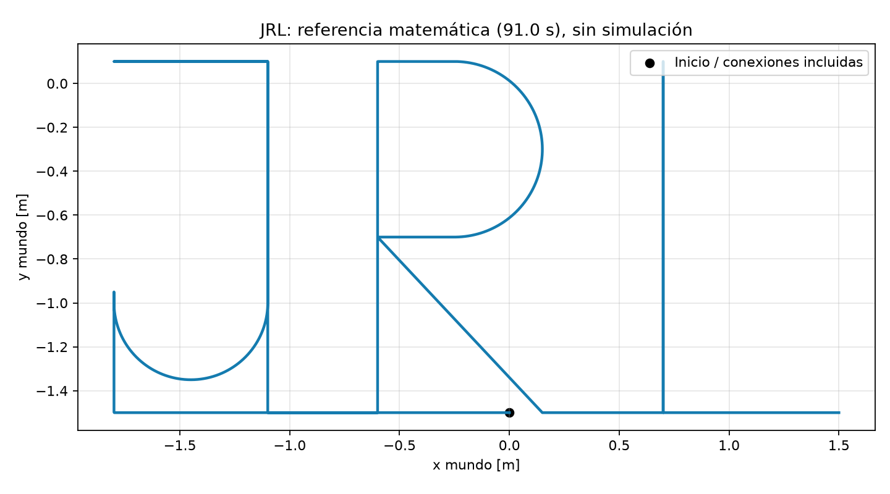

# Workshop 3 — Robots omnidireccionales

Implementación para Jhon Frank Caicedo Coronel, Raziel Alejandro Espinoza Vargas y Luis Fernando Velez Burgos.

## Estado

**Trayectorias `prueba_omni` y `JRL` ejecutadas y verificadas en Jazzy/Harmonic.**
Se compilaron 29 paquetes y pasaron cuatro pruebas numéricas. Se incluyen gráficas,
CSV, métricas y videos reales de ambas trayectorias.

**Mapeo en curso:** `office_0` tiene un mapa parcial y una grabación activa en la
VM; `office_4` sigue pendiente. Este repositorio aún no es la entrega final.
Leer [CONTINUAR_AQUI.md](CONTINUAR_AQUI.md) antes de iniciar o detener procesos.
El informe LaTeX se preparará al finalizar todas las pruebas.

## Incluye

- Cinemática directa e inversa de ruedas mecanum a 45 grados.
- Transformación de velocidades al marco del robot.
- Trayectorias `prueba_omni` y `JRL`.
- Comparación de referencia, posición de Gazebo y odometría; exportación PNG, CSV y métricas JSON.
- Informe y guía para mapear `office_0` y `office_4`.

## Entorno utilizado

La VM anfitriona tiene Ubuntu 26.04.1/Lyrical. Se ejecutó el taller en un contenedor
Ubuntu 24.04.5/Jazzy/Gazebo Harmonic 8.15.0. Ver [guía del contenedor](contenedor/LEEME.md).

## Ejecutar en Ubuntu 24.04

Con ROS 2 Jazzy instalado:

```bash
git clone https://github.com/FernandoVB01/WS3_Robots.git ~/WS3_proyecto
cd ~/WS3_proyecto
bash preparar_ubuntu.sh
```

Si `~/WS3_proyecto` ya existe, utiliza otra ubicación o tu copia existente; no mezcles carpetas. El script instala dependencias con sudo, descarga los repositorios Clearpath y compila. Después sigue [LEEME_EJECUCION.md](LEEME_EJECUCION.md) desde el paso 2.

## Documentación

- [Lista de entregables según la consigna](ENTREGABLES_WS3.md)

- [Guía de ejecución, mapeo y entrega](LEEME_EJECUCION.md)
- [Informe con resultados de trayectorias](INFORME.md)
- [Validación y procedencia](VALIDACION.md)
- [README original del profesor](src/README.md)

## Pruebas sin ROS

```bash
python3 -m unittest discover -s tests -v
```

## Trayectoria de referencia

Esta imagen muestra únicamente la trayectoria matemática; no es una ejecución en Gazebo. Las conexiones entre letras y los trazos repasados son intencionales.



## Procedencia

Basado en [davatorr1009/workshop_03](https://github.com/davatorr1009/workshop_03), commit `2dd570fa2691df231331c01257ede128f96914de`. Se conservan las fuentes originales en `src/` con las modificaciones descritas en el informe. Las dependencias Clearpath se descargan mediante `src/dependencies.repos`; no están incluidas en esta copia.
